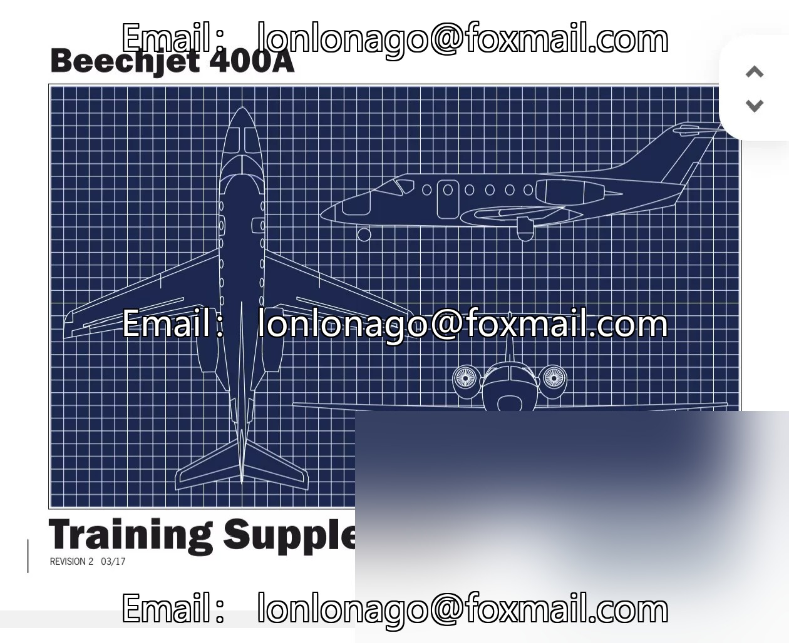
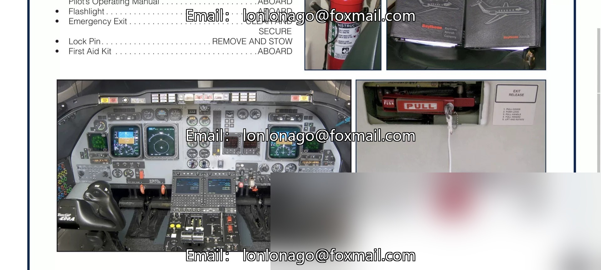
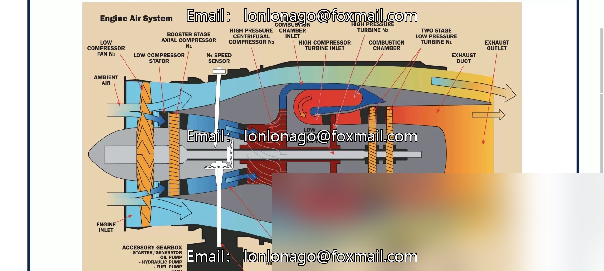

# Beechjet 400A airplane training manual

## Body

Beechjet 400A Aircraft Training Manual
PDF , 130 pages
Penned by SIMCOM Aviation Training, content covers aircraft structures, instruments, engine systems, etc., suitable for pilot training and maintenance reference.
Electronic data, uploaded directly to cloud disk with a link sent immediately.
067222

This is a Beechjet 400A aircraft training manual covering aircraft structure, instruments, engines and other systems, with revision info, operating, emergency and first aid content.

<!-- AI_ENRICHED -->

## Images

## Payment

Here is a pay link on Stripe ( https://buy.stripe.com/3cs8yP7sY87d0vu9AB ). Please contact me lonlonago@foxmail.com after funding $89, and I will send you a complete data files , thank you!

